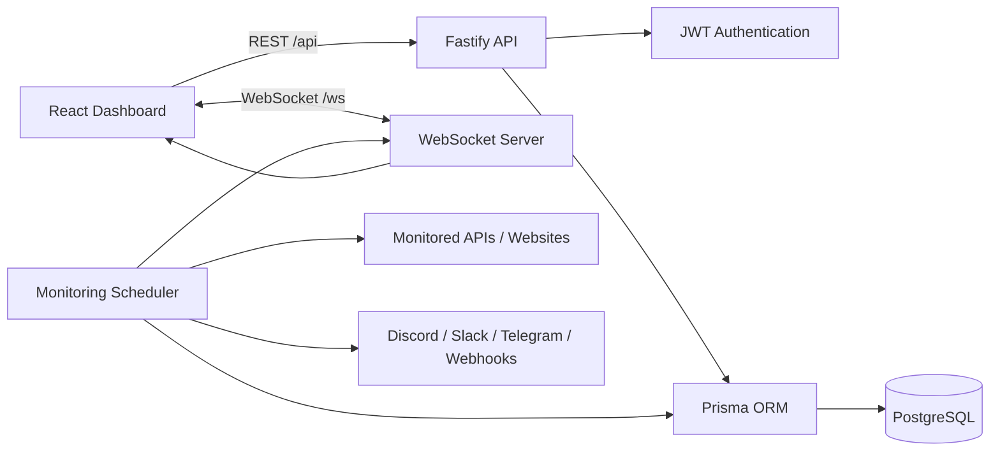

<div align="center">

# Sentinel

**Real-time API uptime, latency, incident, and alert monitoring.**

[](https://www.typescriptlang.org/)
[](https://react.dev/)
[](https://fastify.dev/)
[](https://www.postgresql.org/)
[](https://www.docker.com/)
[](LICENSE)

**[Live Demo](https://sentinel-lyfx.onrender.com)** · [Health](https://sentinel-lyfx.onrender.com/health) · [Report Bug](https://github.com/kmanisk/sentinel/issues) · [Request Feature](https://github.com/kmanisk/sentinel/issues) · [Contributing](CONTRIBUTING.md)

</div>

---

## Overview

**Sentinel** is a self-hosted monitoring platform for tracking API and website availability in real time. It performs scheduled health checks, records response latency, tracks outages and recoveries, streams updates to the dashboard over WebSockets, and sends alerts when monitored services change state.

The project combines a React dashboard with a Fastify/TypeScript backend, Prisma, PostgreSQL, JWT authentication, WebSockets, and Docker-based deployment.

## Features

- **Scheduled uptime checks** with configurable intervals, timeouts, HTTP methods, and expected status codes.
- **Latency history and uptime metrics** displayed through responsive Recharts visualizations.
- **Real-time dashboard updates** over WebSockets without manual refreshes.
- **Incident tracking** for service downtime, recovery, and outage duration.
- **Manual health checks** for immediate endpoint verification.
- **Alert integrations** for Discord, Slack, Telegram, and generic webhooks.
- **JWT authentication** with hashed passwords and protected API routes.
- **Docker Compose deployment** for local or self-hosted environments.
- **Render deployment configuration** with an external PostgreSQL database.

## Architecture



## Tech Stack

| Layer | Technology |
| --- | --- |
| Frontend | React 18, TypeScript, Vite, Tailwind CSS |
| Charts | Recharts |
| Backend | Node.js, Fastify, TypeScript |
| Real-time | `@fastify/websocket`, `ws` |
| Database | PostgreSQL, Prisma ORM |
| Authentication | JWT, `bcryptjs` |
| Deployment | Docker Compose, Render |
| Production database | Neon PostgreSQL |

## Quick Start

### Docker Compose

```bash
git clone https://github.com/kmanisk/sentinel.git
cd sentinel
cp .env.example .env
docker compose up -d --build
```

Then open:

- Dashboard: `http://localhost`
- Health check: `http://localhost/health`

Demo credentials after seeding:

```text
Email:    admin@sentinel.dev
Password: sentinel123
```

> Change the demo credentials and `JWT_SECRET` before exposing an instance publicly.

## Local Development

### Backend

```bash
cd server
npm install
cp ../.env.example .env
npx prisma generate
npx prisma db push
npx tsx prisma/seed.ts
npm run dev
```

The backend runs on `http://localhost:4000` and exposes WebSockets at `ws://localhost:4000/ws`.

### Frontend

```bash
cd client
npm install
npm run dev
```

The Vite development server proxies `/api` and `/ws` to the backend.

## Environment Variables

| Variable | Purpose |
| --- | --- |
| `NODE_ENV` | Runtime environment |
| `PORT` | Fastify server port |
| `HOST` | Server bind address |
| `DATABASE_URL` | PostgreSQL connection string used by Prisma |
| `JWT_SECRET` | Secret used to sign authentication tokens |
| `POSTGRES_USER` | Docker Compose PostgreSQL user |
| `POSTGRES_PASSWORD` | Docker Compose PostgreSQL password |
| `POSTGRES_DB` | Docker Compose PostgreSQL database |
| `DOMAIN_NAME` | Production domain for the self-hosted stack |
| `ACME_EMAIL` | Email used for automatic TLS certificates |

See [`.env.example`](.env.example) for the complete template.

## Production Deployment

### Live deployment

- **Application:** https://sentinel-lyfx.onrender.com
- **Health:** https://sentinel-lyfx.onrender.com/health
- **Web service:** Render Free
- **Database:** Neon PostgreSQL

### Render + Neon PostgreSQL

The included [`render.yaml`](render.yaml) builds both the React frontend and Fastify backend as one Render web service. Production uses a Neon `DATABASE_URL`, keeping the persistent database lifecycle independent from the Render web service.

Required production environment variables:

```text
DATABASE_URL=postgresql://...
JWT_SECRET=<strong-random-secret>
NODE_ENV=production
HOST=0.0.0.0
```

### Docker / VPS

For a self-hosted deployment:

```bash
cp .env.example .env
# Configure production values in .env

docker compose -f docker-compose.prod.yml up -d --build
```

The production Compose configuration includes the application stack and database backup tooling.

## API

### Service

| Method | Endpoint | Description |
| --- | --- | --- |
| `GET` | `/health` | Service health check |
| `GET` | `/metrics` | Application-level telemetry |

### Authentication

| Method | Endpoint | Description |
| --- | --- | --- |
| `POST` | `/api/auth/register` | Create an account |
| `POST` | `/api/auth/login` | Authenticate and receive a JWT |
| `GET` | `/api/auth/me` | Return the authenticated user |

### Monitors

| Method | Endpoint | Description |
| --- | --- | --- |
| `GET` | `/api/monitors` | List monitors and recent status data |
| `POST` | `/api/monitors` | Create a monitor |
| `GET` | `/api/monitors/:id` | Get monitor details and incidents |
| `PUT` | `/api/monitors/:id` | Update monitor configuration |
| `DELETE` | `/api/monitors/:id` | Delete a monitor |
| `POST` | `/api/monitors/:id/check` | Run an immediate check |
| `GET` | `/api/monitors/:id/metrics` | Retrieve latency history |

### Alerts

| Method | Endpoint | Description |
| --- | --- | --- |
| `GET` | `/api/alerts` | List alert channels |
| `POST` | `/api/alerts` | Create an alert channel |
| `DELETE` | `/api/alerts/:id` | Delete an alert channel |
| `POST` | `/api/alerts/:id/test` | Send a test notification |

## Project Structure

```text
sentinel/
├── client/                 # React + Vite dashboard
├── server/                 # Fastify API, scheduler and WebSocket server
│   └── prisma/             # Prisma schema and seed data
├── docker/                 # Reverse-proxy/container configuration
├── docs/                   # Project documentation
├── scripts/                # Backup and restore utilities
├── docker-compose.yml      # Local Docker stack
├── docker-compose.prod.yml # Production Docker stack
└── render.yaml             # Render deployment configuration
```

## Security Notes

- Secrets are supplied through environment variables and are not committed to the repository.
- Passwords are hashed with `bcryptjs`.
- Authentication uses signed JWTs.
- Production containers are configured to avoid unnecessary privileged execution.
- Use a strong unique `JWT_SECRET` and replace all default development credentials before public deployment.

## License

Sentinel is released under the [MIT License](LICENSE).
