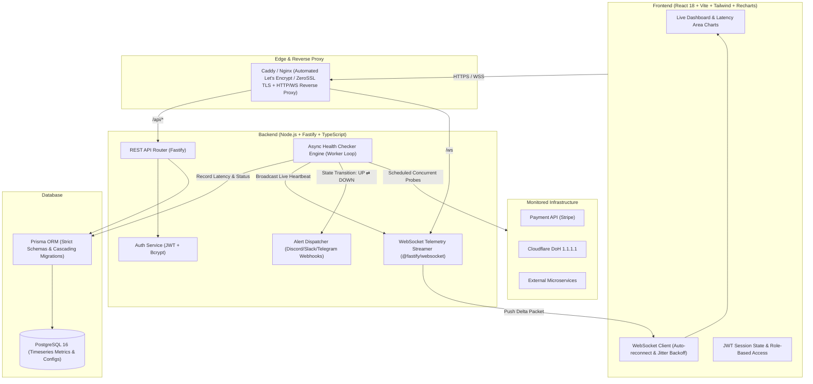

<div align="center">

# Sentinel
### Production-Grade API Health, Latency & Uptime Telemetry Platform

[](https://github.com/kmanisk/sentinel/actions/workflows/ci.yml)
[](https://www.docker.com/)
[](https://react.dev/)
[](https://fastify.dev/)
[](https://www.postgresql.org/)
[](https://opensource.org/licenses/MIT)

**[Live Interactive Demo](https://sentinel-demo.up.railway.app)** · **[Report Bug](https://github.com/kmanisk/sentinel/issues)** · **[Request Feature](https://github.com/kmanisk/sentinel/issues)**

</div>

---

## Overview

**Sentinel** is an enterprise-grade, real-time API health, latency, and uptime monitoring system. Engineered for high-throughput observability, it combines asynchronous precision network probes, live WebSocket telemetry streaming, rolling SLA calculations, anti-flap incident tracking, and automated multi-channel webhook alerting.

Designed from day one with **DevOps discipline**, Sentinel features fully containerized multi-stage Docker builds, Nginx reverse proxy routing with WebSocket upgrades and TLS termination, and automated GitHub Actions CI/CD pipelines testing against a live PostgreSQL service container.

---

## System Architecture



---

## Key Features & Engineering Highlights

- **Precision Async Network Probing**: Measures granular network timings (DNS resolution time, Time to First Byte [TTFB], and end-to-end response latency) with strict timeout abortion (`AbortController`).
- **Real-Time Streaming Telemetry**: Zero-refresh dashboard powered by native WebSockets with exponential backoff auto-reconnect and heartbeat keepalive frames.
- **Interactive Time-Series Visualizations**: High-performance SVG latency area charts and rolling 24h availability sparklines built with Recharts.
- **Anti-Flap Incident Management**: Tracks outages with state transition debouncing, recording exact incident start times, recovery times, and duration in seconds.
- **Multi-Channel Alert Dispatcher**: Immediate notifications via **Discord Webhooks** (rich embed formatting), **Slack Webhooks**, **Telegram Bots**, and custom HTTP webhooks.
- **Zero-Trust Auth & Role Model**: JSON Web Tokens (JWT) signed with HMAC-SHA256 and salt-hashed passwords via `bcryptjs`.
- **Production Containerization**: Multi-stage lean Dockerfiles for both client and server, stripping build dependencies for minimal image footprints.
- **Full CI/CD Automation**: GitHub Actions running automated type checking, database schema pushes to transient PostgreSQL containers, Vite production bundling, and container layer validation.

---

## Technology Stack

| Domain | Technology | Purpose |
| :--- | :--- | :--- |
| **Frontend** | React 18, TypeScript, Vite, Tailwind CSS | High-performance SPA with modern dark-mode UI |
| **Data Viz** | Recharts, Lucide Icons | Responsive SVG charts and crisp SVG icons |
| **Backend** | Node.js 20, Fastify, TypeScript | Low-overhead, high-throughput asynchronous HTTP engine |
| **Real-time** | `@fastify/websocket`, `ws` | Bidirectional real-time event streaming |
| **Database & ORM** | PostgreSQL 16, Prisma ORM | Relational consistency with type-safe schema queries |
| **Authentication** | `@fastify/jwt`, `bcryptjs` | Stateless JWT session authorization |
| **Webhooks** | Discord, Slack, Telegram APIs | Automated incident dispatching |
| **Reverse Proxy** | Nginx Alpine, Let's Encrypt Certbot | SSL termination, WebSocket proxying, security headers |
| **Containers** | Docker, Docker Compose | Reproducible environments & isolated container networks |
| **CI / CD** | GitHub Actions, GHCR | Automated lint, test, container build, and deployment |

---

## Quickstart & Local Setup

### Option A: 1-Command Docker Compose (Recommended)

Run the entire stack (PostgreSQL, Fastify API, React SPA, and Nginx) in isolated containers:

```bash
# Clone the repository
git clone https://github.com/kmanisk/sentinel.git
cd sentinel

# Copy environment variables
cp .env.example .env

# Spin up the complete stack
docker compose up -d --build
```

- **Web Dashboard:** [http://localhost](http://localhost)
- **API Health Check:** [http://localhost/health](http://localhost/health)
- **Default Demo Credentials:** `admin@sentinel.dev` / `sentinel123`

---

### Option B: Local Development Workflow

#### 1. Backend Setup

```bash
cd server

# Install dependencies
npm install

# Set up local environment
cp ../.env.example .env

# Generate Prisma client and migrate database
npx prisma generate
npx prisma db push

# Seed sample monitors and admin user
npx tsx prisma/seed.ts

# Start development server with live reload
npm run dev
```
*Server boots on `http://localhost:4000` with WebSocket endpoint at `ws://localhost:4000/ws`.*

#### 2. Frontend Setup

```bash
cd client

# Install dependencies
npm install

# Start Vite dev server with proxy to backend
npm run dev
```
*Frontend runs on `http://localhost:3000`.*

---

## Production Deployment (VPS + DuckDNS + Caddy)

Sentinel includes an automated zero-config production stack featuring **Caddy** (automatic TLS / Let's Encrypt certificates + HTTP/3) and an automated daily database backup service.

### 1. Free Subdomain via DuckDNS (30 seconds)
1. Go to [duckdns.org](https://www.duckdns.org) and log in with GitHub.
2. Create a free subdomain (e.g., `sentinel-mon.duckdns.org`).
3. Set the IP address to your VPS public IPv4 address.

### 2. Launch on Oracle Cloud (ARM64 Ampere or x86 VPS)
```bash
# Clone on your VPS
git clone https://github.com/kmanisk/sentinel.git /opt/sentinel
cd /opt/sentinel

# Configure domain and secrets
cp .env.example .env
nano .env
# Set DOMAIN_NAME=sentinel-mon.duckdns.org
# Set ACME_EMAIL=your-email@example.com

# Deploy production stack (Postgres + Server + Client + Caddy + DB Backup)
docker compose -f docker-compose.prod.yml up -d
```
Caddy will automatically provision and install SSL certificates for your DuckDNS domain without requiring certbot sidecars or renewal crons.

---

## Automated Database Backups & Disaster Recovery

Because free cloud tiers can occasionally experience service changes, Sentinel includes automated backup mechanisms to make migrations effortless:

- **Automated Daily Backups:** The `db_backup` service in `docker-compose.prod.yml` dumps and gzips the database every night into `./backups` with a rolling 7-day retention policy.
- **Manual Instant Backup:**
  ```bash
  ./scripts/backup-db.sh
  ```
- **1-Command Restore / Disaster Recovery:**
  ```bash
  ./scripts/restore-db.sh ./backups/sentinel_backup_20261016_231000.sql.gz
  ```

---

## Multi-Architecture Docker Pipeline

Sentinel builds multi-architecture images for both **`linux/amd64`** (standard x86 VPS) and **`linux/arm64`** (Oracle Cloud Ampere A1).

Cross-compilation is handled automatically via GitHub Actions with QEMU and Docker Buildx, outputting OCI-compliant multi-arch manifests directly to GHCR.

## API Reference

### Health & Telemetry
- `GET /health` — Service liveness probe.
- `GET /metrics` — High-level telemetry (monitor counts, total checks, active WS clients, memory RSS).

### Authentication
- `POST /api/auth/register` — Create user account (`{ email, password, name }`).
- `POST /api/auth/login` — Authenticate and receive JWT token (`{ email, password }`).
- `GET /api/auth/me` — Retrieve active user session profile (requires Bearer token).

### Monitors
- `GET /api/monitors` — List all monitored endpoints with recent sparkline heartbeats and 24h uptime.
- `POST /api/monitors` — Register new monitor (`{ name, url, method, interval, timeout, expectedStatus }`).
- `GET /api/monitors/:id` — Get detailed monitor stats and open/closed incidents.
- `PUT /api/monitors/:id` — Update monitor settings and reconfigure scheduler.
- `DELETE /api/monitors/:id` — Delete monitor and cancel active polling timer.
- `POST /api/monitors/:id/check` — Trigger immediate on-demand health check.
- `GET /api/monitors/:id/metrics?limit=60` — Fetch chronological time-series latency records for Recharts.

### Alerting & Webhooks
- `GET /api/alerts` — List configured notification channels.
- `POST /api/alerts` — Register alert destination (`{ type: "DISCORD"|"SLACK"|"TELEGRAM"|"WEBHOOK", destination }`).
- `DELETE /api/alerts/:id` — Remove alert destination.
- `POST /api/alerts/:id/test` — Trigger test alert payload.

---

## Security Best Practices

- **Strict CORS & CSP Headers**: Configured across Nginx and Fastify with frame protection (`SAMEORIGIN`), XSS filtering, and MIME sniffing prevention (`nosniff`).
- **Non-Root Docker Execution**: Production containers drop root privileges and run under the unprivileged `node` and `nginx` users.
- **Stateless Secrets**: Zero secrets committed to version control; all database passwords, JWT secrets, and webhook tokens are injected at runtime via environment variables.

---

## License

This project is open-source under the [MIT License](LICENSE).
