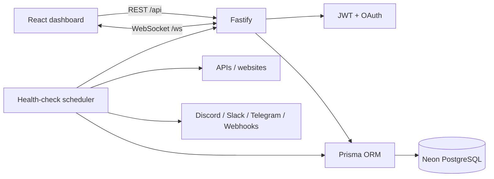

<div align="center">


# Sentinel

**Real-time uptime, latency, incident and alert monitoring for APIs and websites.**

[](https://sentinel-lyfx.onrender.com)
[](https://www.typescriptlang.org/)
[](https://react.dev/)
[](https://fastify.dev/)
[](https://www.postgresql.org/)
[](https://github.com/kmanisk/sentinel/stargazers)
[](LICENSE)

### [Open the live dashboard →](https://sentinel-lyfx.onrender.com)

[Health check](https://sentinel-lyfx.onrender.com/health) · [Issues](https://github.com/kmanisk/sentinel/issues) · [Contributing](CONTRIBUTING.md)

</div>

---

## Live deployment

The public instance is the primary way to try Sentinel.

| Component | Live service |
| --- | --- |
| Dashboard + API | **https://sentinel-lyfx.onrender.com** |
| Health endpoint | **https://sentinel-lyfx.onrender.com/health** |
| Web service | Render |
| Production database | Neon PostgreSQL |
| Real-time transport | WebSocket `/ws` |

Demo account:

```text
Email:    admin@sentinel.dev
Password: sentinel123
```

> Render's free web service can cold-start after inactivity, so the first request may take longer than normal.

## What Sentinel does

Sentinel continuously checks configured HTTP endpoints and keeps the operational data in one place:

- scheduled HTTP health checks with configurable intervals, timeouts and expected status codes;
- response-time history and rolling 24-hour uptime;
- outage and recovery incident tracking;
- live dashboard updates over WebSockets;
- manual checks for immediate verification;
- Discord, Slack, Telegram and generic webhook alerts;
- email/password authentication with JWT sessions;
- optional **Google** and **GitHub** OAuth sign-in.

The frontend is React + Vite, while Fastify runs the API, scheduler, authentication and WebSocket stream from the same production service.

## Architecture



## Stack

| Area | Technology |
| --- | --- |
| Frontend | React 18, TypeScript, Vite, Tailwind CSS |
| Charts | Recharts |
| Backend | Node.js, Fastify, TypeScript |
| Real-time | WebSockets |
| Database | PostgreSQL, Prisma ORM |
| Auth | JWT, bcrypt, Google OAuth, GitHub OAuth |
| Production | Render + Neon PostgreSQL |
| Self-hosting | Docker Compose |

## Authentication

Email/password works without additional configuration.

Google and GitHub OAuth are implemented but intentionally remain disabled until provider credentials are supplied. Configure these variables on the server:

```env
APP_URL=https://sentinel-lyfx.onrender.com

GOOGLE_CLIENT_ID=
GOOGLE_CLIENT_SECRET=

GITHUB_CLIENT_ID=
GITHUB_CLIENT_SECRET=
```

Use these OAuth callback URLs when creating the provider applications:

```text
Google: https://sentinel-lyfx.onrender.com/api/auth/oauth/google/callback
GitHub: https://sentinel-lyfx.onrender.com/api/auth/oauth/github/callback
```

Sentinel exposes `GET /api/auth/providers`, so the frontend only enables OAuth buttons when that provider is actually configured.

## Local hosting and testing

For the quickest local stack:

```bash
git clone https://github.com/kmanisk/sentinel.git
cd sentinel
cp .env.example .env
docker compose up -d --build
```

For frontend/backend development, run `npm install && npm run dev` inside both `server/` and `client/`. The Vite dev server proxies `/api` and `/ws` to Fastify.

Useful local endpoints:

```text
Dashboard: http://localhost
API:       http://localhost:4000
Health:    http://localhost:4000/health
```

## API surface

| Method | Endpoint | Purpose |
| --- | --- | --- |
| `GET` | `/health` | Service health |
| `GET` | `/metrics` | Application telemetry |
| `POST` | `/api/auth/register` | Create an account |
| `POST` | `/api/auth/login` | Email/password login |
| `GET` | `/api/auth/me` | Current authenticated user |
| `GET` | `/api/auth/providers` | Enabled OAuth providers |
| `GET` | `/api/auth/oauth/:provider` | Start Google/GitHub OAuth |
| `GET` | `/api/monitors` | List monitors |
| `POST` | `/api/monitors` | Create a monitor |
| `PUT` | `/api/monitors/:id` | Update a monitor |
| `DELETE` | `/api/monitors/:id` | Delete a monitor |
| `POST` | `/api/monitors/:id/check` | Run an immediate check |
| `GET` | `/api/monitors/:id/metrics` | Latency history |
| `GET` | `/api/alerts` | List alert channels |
| `POST` | `/api/alerts` | Add an alert channel |
| `POST` | `/api/alerts/:id/test` | Test an alert channel |

## Repository layout

```text
sentinel/
├── client/                 # React dashboard
├── server/                 # Fastify API, scheduler, auth and WebSockets
│   └── prisma/             # schema + seed data
├── docker/                 # self-hosted reverse-proxy configuration
├── docs/
├── scripts/
├── docker-compose.yml
├── docker-compose.prod.yml
└── render.yaml
```

## Security notes

- Production secrets are environment variables and are not committed.
- Passwords are hashed with bcrypt.
- OAuth uses a signed, short-lived state token before the provider callback.
- JWTs are used for authenticated API requests.
- Replace the seeded demo credentials and use a strong `JWT_SECRET` for private deployments.

## License

MIT — see [LICENSE](LICENSE).
